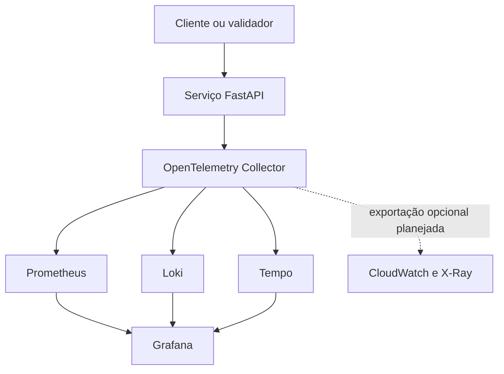
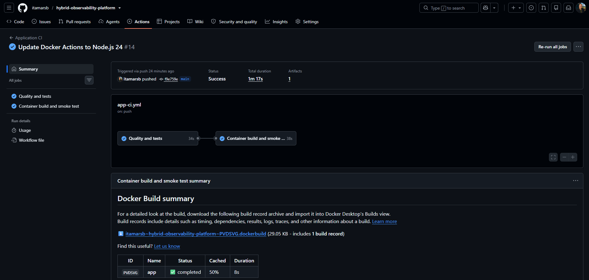
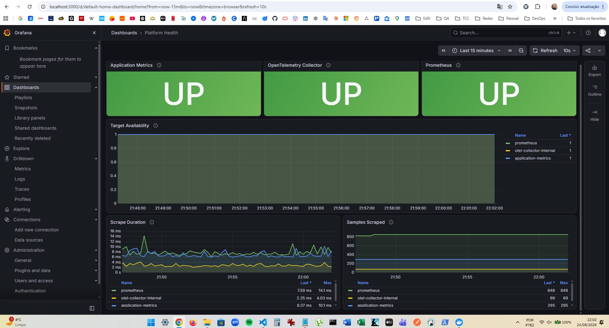
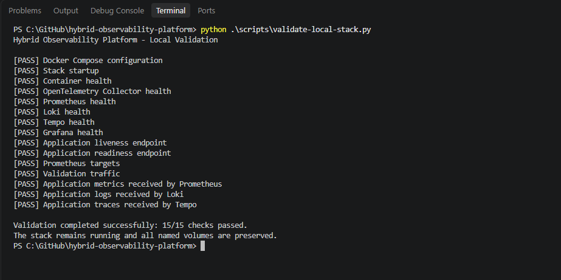
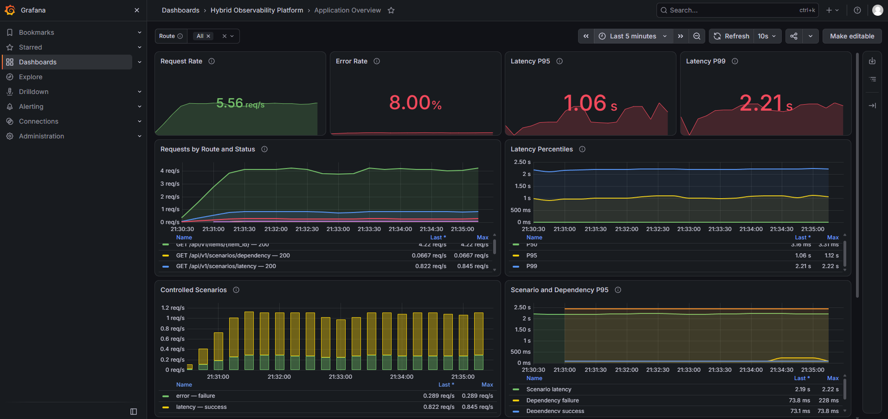

# Hybrid Observability Platform

**Idioma:** [English (US)](README.md) | **Português (Brasil)**

[](https://github.com/itamarsb/hybrid-observability-platform/actions/workflows/app-ci.yml)

Plataforma de observabilidade que prioriza a execução local e coleta métricas, logs e traces
de um serviço FastAPI instrumentado com OpenTelemetry. Prometheus, Loki, Tempo e Grafana
oferecem armazenamento local, consultas, visualização e recursos de investigação. Uma integração
opcional com a AWS está planejada para validações híbridas de curta duração.

> **Situação:** a aplicação instrumentada, a stack local de seis serviços, o painel de saúde
> provisionado no Grafana, a CI da aplicação e o validador local de ponta a ponta estão operacionais.
> Testes de carga, alertas, CI da plataforma e a integração opcional com a AWS permanecem no roadmap.

## O que este projeto demonstra

- instrumentação da aplicação independente de fornecedor, com OpenTelemetry;
- pipelines de telemetria para múltiplos sinais por meio do OpenTelemetry Collector;
- métricas, logs e traces locais com Prometheus, Loki e Tempo;
- fontes de dados provisionadas no Grafana e painel de saúde da plataforma versionado;
- implantação local reproduzível com Docker Compose;
- cenários controlados de latência, dependências e erros;
- validação automatizada de ponta a ponta da saúde dos serviços e da entrega de telemetria;
- verificações de qualidade da aplicação, testes, build do contêiner e testes de fumaça (smoke tests) no GitHub Actions;
- controles práticos de segredos, retenção, cardinalidade e custos futuros de nuvem.

## Arquitetura



O armazenamento local é o padrão. A futura exportação para a AWS deverá ser habilitada
explicitamente e não substituirá os back-ends locais.

| Sinal | Origem | Destino local atual | Destino planejado na AWS |
|:---:|:---:|:---:|:---:|
| Métricas | FastAPI / Collector | Prometheus | CloudWatch Metrics |
| Logs | FastAPI / contêineres | Loki | CloudWatch Logs |
| Traces | FastAPI | Tempo | AWS X-Ray |
| Visualização | Todos os back-ends locais | Grafana | Consoles da AWS / fontes de dados do Grafana |

Consulte a [documentação de arquitetura](docs/architecture.md) para conhecer as responsabilidades
dos componentes e os fluxos de telemetria.

## Tecnologias utilizadas

| Área | Tecnologia | Situação |
|:---:|:---:|:---:|
| Carga de trabalho de referência | Python, FastAPI, Uvicorn | Implementado |
| Instrumentação e coleta | OpenTelemetry SDK e Collector | Implementado |
| Métricas | Prometheus | Implementado |
| Logs | Loki | Implementado |
| Traces | Tempo | Implementado |
| Visualização | Grafana | Implementado |
| Orquestração local | Docker Compose | Implementado |
| CI da aplicação | GitHub Actions | Implementado |
| Validação de ponta a ponta | Biblioteca padrão do Python | Implementado |
| Testes de carga | k6 | Planejado |
| Provisionamento na AWS | Terraform | Planejado |

## Início rápido

### Pré-requisitos

- Python 3.12 ou posterior;
- Docker Engine ou Docker Desktop com Docker Compose v2;
- Git.

Clone o repositório e acesse seu diretório:

```bash
git clone https://github.com/itamarsb/hybrid-observability-platform.git
cd hybrid-observability-platform
```

Execute o validador de ponta a ponta no Windows PowerShell:

```powershell
python .\scripts\validate-local-stack.py
```

No Linux ou macOS:

```bash
python3 ./scripts/validate-local-stack.py
```

O validador constrói e inicia a stack, verifica os seis serviços, gera tráfego controlado
e verifica se as métricas, os logs e os traces chegaram aos respectivos back-ends.
A verificação adicional de HTTP 503 compara um ID de trace recém-retornado com um evento
estruturado no Loki e o span de servidor correspondente no Tempo, além de conferir as métricas
do Prometheus agregadas por rota. A verificação foi bem-sucedida em um ensaio de integração
local em 20/11/2026 (2026-11-20), juntamente com 11 testes unitários offline de correlação
aprovados. O validador mantém a stack em execução e preserva todos os volumes nomeados.

Após a validação, acesse:

| Interface | URL |
|:---:|:---:|
| Documentação da API da aplicação | <http://127.0.0.1:8000/docs> |
| Grafana | <http://127.0.0.1:3000> |
| Prometheus | <http://127.0.0.1:9090> |

No modo local, o Grafana utiliza `admin` / `admin` por padrão, a menos que as credenciais
sejam substituídas por variáveis de ambiente.

Encerre os contêineres e remova a rede, preservando os volumes de telemetria e do Grafana:

```bash
docker compose down
```

Não adicione `--volumes` ou `-v`, a menos que a exclusão permanente de todos os dados locais
do projeto seja intencional.

Para os critérios completos de validação e orientações de diagnóstico, consulte
[Validação da stack local](docs/operations/local-stack-validation.md).

Para investigar uma falha HTTP de uma requisição específica utilizando Prometheus, Loki e Tempo,
consulte o [Runbook de investigação de erros HTTP](docs/operations/http-error-investigation.md).
O runbook documenta o fluxo de investigação manual. A verificação automatizada da correlação
por requisição está implementada no validador local; seu primeiro ensaio de integração local
bem-sucedido está documentado no
[Registro de validação da correlação HTTP](docs/operations/http-correlation-validation-2026-11-20.md).

## Modos de operação

### Local

O modo padrão implementado não exige conta AWS nem credenciais de nuvem. A telemetria
permanece em volumes Docker do projeto, com retenção limitada.

### Híbrido — planejado

O modo híbrido planejado acrescentará exporters selecionados para a AWS, mantendo o pipeline
local ativo. Destina-se à validação de integração de curta duração, e não à duplicação permanente
de toda a telemetria.

## Estrutura do repositório

```text
.
├── .github/workflows/        # CI da aplicação
├── app/                      # Serviço FastAPI instrumentado e testes
├── docs/
│   ├── adr/                  # Registros de decisões arquiteturais
│   ├── operations/           # Guias de validação e diagnóstico
│   ├── screenshots/          # Evidências revisadas e sanitizadas
│   └── architecture.md       # Arquitetura do sistema e fluxo de telemetria
├── observability/
│   ├── collector/            # Configuração do OpenTelemetry Collector
│   ├── grafana/              # Provisionamento e definições dos painéis
│   ├── loki/                 # Configuração do back-end de logs
│   ├── prometheus/           # Configuração do back-end de métricas
│   └── tempo/                # Configuração do back-end de traces
├── scripts/                  # Ferramentas de validação multiplataforma
└── compose.yaml              # Plataforma local de seis serviços
```

Os diretórios são adicionados somente quando contêm artefatos funcionais. Os componentes
planejados são descritos no roadmap, em vez de serem representados por diretórios vazios.

## Decisões de engenharia

- [ADR 0001 — Utilizar o OpenTelemetry Collector](docs/adr/0001-use-opentelemetry-collector.md)
- [ADR 0002 — Utilizar uma stack local de observabilidade com Grafana](docs/adr/0002-use-prometheus-instead-of-mimir.md)
- [ADR 0003 — Manter a telemetria local efêmera](docs/adr/0003-store-telemetry-locally.md)
- [ADR 0004 — Tornar opcional a exportação para a AWS](docs/adr/0004-make-cloudwatch-export-optional.md)

## Evidências de validação

O repositório mantém um pequeno conjunto de capturas de tela revisadas como evidências de
engenharia reproduzível. A telemetria de execução e os dados gerados pelos back-ends permanecem
fora do Git.

### CI da aplicação

As verificações de qualidade, os testes automatizados, o build do contêiner e os testes de fumaça
são concluídos com sucesso no GitHub Actions.



### Painel de saúde da plataforma provisionado

O Grafana consulta os dados do Prometheus provisionado e apresenta como disponíveis o endpoint
de métricas da aplicação, o OpenTelemetry Collector e os alvos do Prometheus.



### Validação local de ponta a ponta

O validador multiplataforma confirma a saúde dos serviços e verifica a entrega das métricas
da aplicação ao Prometheus, dos logs ao Loki e dos traces ao Tempo.



Um [registro separado de validação local da correlação HTTP](docs/operations/http-correlation-validation-2026-11-20.md)
documenta uma execução bem-sucedida com 16/16 verificações aprovadas e 11 testes unitários
aprovados em 20/11/2026 (2026-11-20). A captura de tela acima pertence a uma execução
anterior e não deve ser interpretada como evidência da execução mais recente de 16 verificações.
Uma investigação manual distinta no Grafana, realizada em 21/11/2026 (2026-11-21), recuperou
registros correspondentes no Loki e um trace no Tempo pelo mesmo ID da requisição. Consulte
o registro de validação para acessar as capturas existentes, que mantêm seus nomes genéricos originais.

### Telemetria da aplicação sob carga controlada

O painel provisionado da aplicação apresenta taxa de requisições, taxa de erros HTTP, latência
P95 e P99, comportamento por rota, cenários controlados, dependências simuladas e logs estruturados
correlacionados.



## Controles operacionais e de segurança

- O modo local é o padrão seguro.
- Segredos, credenciais, estado do Terraform e telemetria de execução nunca são versionados.
- As interfaces de observabilidade escutam localmente, salvo quando um cenário documentado exige outra configuração.
- A retenção inicial é de 48 horas para métricas e 24 horas para logs e traces.
- A amostragem de traces, a filtragem de logs e a cardinalidade das métricas são validadas antes da exportação para a AWS.
- Recursos híbridos futuros deverão receber tags, ter duração limitada e ser removidos após a validação.
- Capturas de tela e dados de exemplo não devem expor IDs de contas, credenciais, tokens ou dados pessoais.

Consulte [SECURITY.md](SECURITY.md) para conhecer os procedimentos de comunicação de vulnerabilidades
e os requisitos de segurança.

## Roadmap

- [x] Definir a arquitetura, o escopo e as decisões de engenharia
- [x] Implementar e testar o serviço FastAPI instrumentado
- [x] Adicionar a stack local de OpenTelemetry, Prometheus, Loki, Tempo e Grafana
- [x] Provisionar as fontes de dados do Grafana e o painel de saúde da plataforma
- [x] Adicionar validação local reproduzível de ponta a ponta
- [x] Publicar evidências iniciais de CI, painéis e validação
- [x] Adicionar painéis de telemetria da aplicação e links de investigação entre sinais
- [ ] Adicionar alertas e regras de gravação (recording rules) do Prometheus
- [ ] Adicionar cargas de trabalho do k6 e cenários de falha sustentada
- [ ] Executar validação completa da plataforma, verificações de segurança e de limpeza dos recursos na CI
- [ ] Provisionar a integração opcional com a AWS utilizando Terraform
- [x] Publicar um runbook completo de investigação de métricas, logs e traces
- [x] Implementar verificações automatizadas de correlação por requisição HTTP 503 entre Loki e Tempo
- [x] Registrar uma execução local bem-sucedida da verificação de correlação na stack completa

## Critérios de conclusão

A primeira versão estará concluída quando um novo usuário puder clonar o repositório, iniciar
o modo local, gerar uma carga de trabalho controlada, investigar uma requisição por meio de
métricas, logs e traces, executar verificações automatizadas da plataforma na CI e remover os
recursos do projeto com os comandos documentados. O modo híbrido deverá demonstrar adicionalmente
a exportação limitada para a AWS e a remoção bem-sucedida dos recursos.

## Fora do escopo

- hospedagem de produção ou disponibilidade 24/7;
- serviço gerenciado de observabilidade;
- arquivamento de telemetria de longo prazo;
- certificação de conformidade para produção;
- implantação em Kubernetes na versão inicial;
- monitoramento de sistemas de terceiros sem autorização.

## Licença

Licenciado sob a [Apache License 2.0](LICENSE).

---

## 📈 Métricas do repositório

<p align="center">

<a href="https://info.flagcounter.com/2wro"></a>

</p>
